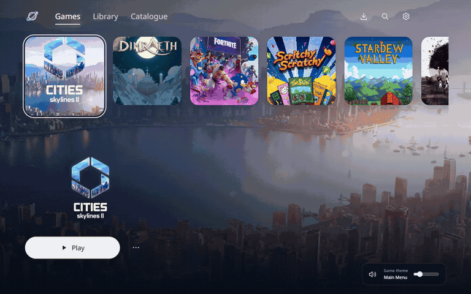

# Orbit

A PS5-inspired Electron launcher for `D:\Games`. Game artwork fills the screen, with a compact game row and minimal controls.

[](docs/media/orbit-demo.mp4)

[Watch the full walkthrough](docs/media/orbit-demo.mp4)

Double-click `Launch Orbit.cmd`, or open `release\Orbit\Orbit.exe` after packaging. Keep the entire `release\Orbit` folder together when moving the app. The packaged app runs without Node.js. Games and Library work offline; the PlayZip catalogue requires an internet connection.

The header doubles as the window title bar. Drag its empty space to move the window, or double-click to maximize and restore. Native minimize, maximize, and close controls sit over the artwork and retain Windows Snap layouts. Navigation and utility buttons remain clickable. F11 switches to fullscreen.

The Orbit mark lives in `public/brand/orbit-mark.svg`, with its app tile in `public/favicon.svg`. Building generates PNG and multi-resolution ICO assets. Packaging applies the icon and Orbit product information to `Orbit.exe`.

## Development

Requires Node.js 22 or later on Windows.

```powershell
npm install
npm start
```

If your npm configuration blocks Electron's install script, run `node node_modules/electron/install.js` once after installing.

`npm run dev` opens the interface at http://127.0.0.1:5173. The browser preview reads your real library, but game launching and native folder dialogs run in Electron.

```powershell
npm test
npm run smoke
npm run package
```

The smoke check loads the production UI in a hidden, sandboxed Electron window and checks the preload bridge, game detection, artwork, launch error feedback, and catalogue UI using the tracked catalogue samples. It checks pagination, search, iframe creation and removal, catalogue errors, and title-bar spacing at 900 and 1280 pixels. It intercepts launches, so it does not start a game. It needs at least one installed game in `D:\Games`.

To also exercise native maximize, fullscreen, minimize, and restore in a visible window, run `$env:ORBIT_WINDOW_CHECK = '1'; npm run smoke` in PowerShell. Remove the variable afterward with `Remove-Item Env:ORBIT_WINDOW_CHECK`.

`npm run record:demo` refreshes the silent MP4 walkthrough and animated README preview in `docs/media`. It requires FFmpeg on PATH and games in `D:\Games`. It records the Electron renderer without launching games or starting downloads.

## Controls

| Key | Action |
| --- | --- |
| Left / Right | Select game |
| Enter | Play selected game when a tile is focused |
| / | Search |
| F11 | Toggle fullscreen |
| Escape | Close dialog or return to Games |

Use the menu beside Play to favorite a game, open its folder, or choose its executable. Library has All, Favorites, and Recent filters. Recent tracks launches made through Orbit, not playtime or game progress. Settings lets you change the game folder, rescan, or view keyboard controls.

The scanner excludes common crash handlers, installers, and support executables. It recognizes the five games in this library and searches up to six levels into other game folders. A unique executable matching the game name is selected automatically. When detection is ambiguous, choose the executable before playing. Games are launched directly with their own directory as the working directory, without a shell or elevated privileges.

Favorites, recent launches, folder choice, and executable overrides are saved in Electron's user data directory at `%APPDATA%\orbit-game-launcher\library.json`. Game files are only read and launched.

## PlayZip catalogue

Catalogue reads PlayZip's public HTML listings through the Electron main process, or through `/api/catalogue` in the development preview. It supports page navigation and direct page entry, search, genre filters, and Popular/Latest ordering. Pages are cached in memory for five minutes, up to 32 queries. Only the requested page is fetched.

Selecting a catalogue card opens its original `https://playzip.com/game/{id}` page in an iframe modal. The frame is sandboxed, has no launcher bridge or Node access, and is removed when the modal closes. Top-level navigation is blocked. In Electron, download links opened by the selected game's PlayZip download page are handed to the download manager; no popup window is opened. Other popups are denied. The browser preview does not enable downloads. Orbit does not remove or override PlayZip's embedding restrictions. The site currently allows embedding, but that could change.

Remote HTML is parsed as an inert document for listing metadata. Its scripts are not executed in the launcher. The catalogue fetcher accepts only fixed PlayZip routes and validated query values, with a timeout and response-size limit. See `research/playzip/README.md` for the inspected routes and markup contract.

## Downloads and imports

Open a catalogue game and use PlayZip's normal Download controls. Orbit associates the resulting transfer with the selected game. The download icon opens the queue, with progress, pause, resume where supported, and cancel controls. The game and metadata are captured when the download starts, so opening a different catalogue page does not relabel an existing transfer.

Completed single-file ZIP and 7z archives are extracted into a private staging area beneath the game's destination root, then added to Library. Existing game folders are preserved; name collisions get a numbered folder. Extraction does not run installers or game executables. Game titles, PlayZip and Steam IDs, and artwork URLs are saved in `.orbit-game.json`. Artwork is cached in `.orbit-assets` when available, and served locally for offline use. These internal folders and incomplete imports are excluded from Library scans.

If more than one executable is plausible, the queue shows Choose executable. Archives with no detected executable also require a manual choice. Installers, multipart downloads, encrypted archives, and unsupported formats need manual handling. A failed import keeps the downloaded archive for Retry import. Import archive in a game's modal can import an archive downloaded elsewhere while retaining that game's metadata; the queue also offers a general archive picker.

Transfer history is saved to `%APPDATA%\orbit-game-launcher\downloads.json`. Downloads go to `<game root>\.orbit-staging\<job id>`. Completed archives are retained. Pause/resume applies while Orbit remains open and depends on the file server; after restarting Orbit, an unfinished transfer must be started again from the site. An interrupted extraction of a fully downloaded archive can be retried. The first version does not combine multipart archives, accept archive passwords, run installers, or automatically launch imported games.

The importer validates archive paths, link entries, file counts, declared sizes, and free space before extraction, then checks the extracted tree. It bundles the unmodified 7-Zip Extra 26.04 console executable, with license and origin information under `vendor/7zip` and `resources/7zip` in packaged builds.

The native end-to-end fixture check is `scripts/check-download-import.cjs`, run with Electron and `ELECTRON_RUN_AS_NODE` unset. It downloads a tiny local test ZIP through a sandboxed iframe, extracts it, checks executable detection and library metadata, and checks local artwork delivery. It never launches the fixture executable or downloads a real game.

## Game theme music

Selecting an installed game plays one track from that game's soundtrack, stored locally for offline playback. Tracks loop and fade in at a quiet default volume. The bottom-right player provides mute and volume controls and remembers both settings. Music stops in Library and Catalogue, while Orbit is hidden, and when a game launches. Selecting another game starts its own track. See `public/music/SOURCES.md` for the source of each recording.

## Automatic and assisted game setup

Orbit fills missing artwork and game details in the background when a game is discovered or imported. It uses a saved Steam ID, a Steam ID found in the installed files, or a unique exact title match against Steam's public store. Uncertain matches stay unassigned. Successful and unmatched lookups are cached for seven days; Auto-configure in the setup panel checks immediately. The setting can be turned off in Settings.

Open Game details, then Artwork & music, to search and select a Steam match, choose cover/wallpaper/logo images, find theme music in the installed game folder, or choose a local audio file. Downloads and chosen files are cached beneath the game's `.orbit-assets` folder and recorded in `.orbit-game.json`. Your manually chosen artwork and music survive online metadata refreshes. Steam lookups use the game title or Steam ID, never the installation path.

Music is automatically selected when a unique clearly named playable menu/theme file is present. Otherwise Orbit offers candidates or a local file chooser. Packed sound banks and encrypted game archives require a separately available soundtrack file. Existing bundled game themes continue to work.

## Artwork

Artwork and logos are cached locally from each game's Steam store assets. They remain the property of their respective rights holders. These assets are for this personal launcher. The UI uses Noto Sans from the existing Cities: Skylines II launcher installation, under the SIL Open Font License. See `public/fonts/OFL.txt`.

Reference: [Sony's PS5 quick start guide](https://www.playstation.com/content/dam/global_pdc/en/corporate/support/manuals/ps5-docs/1200a/CFI-12XXA_PS5_Quick_Start_Guide%24en.pdf). Orbit is an independent personal project.
